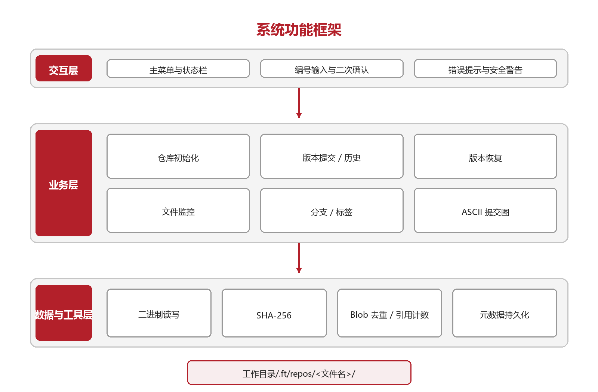
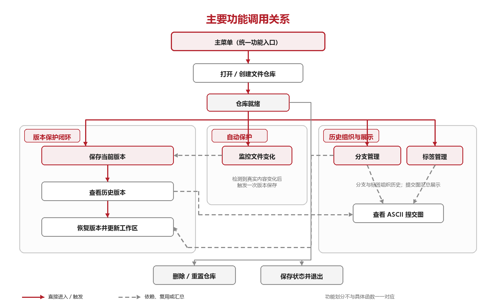
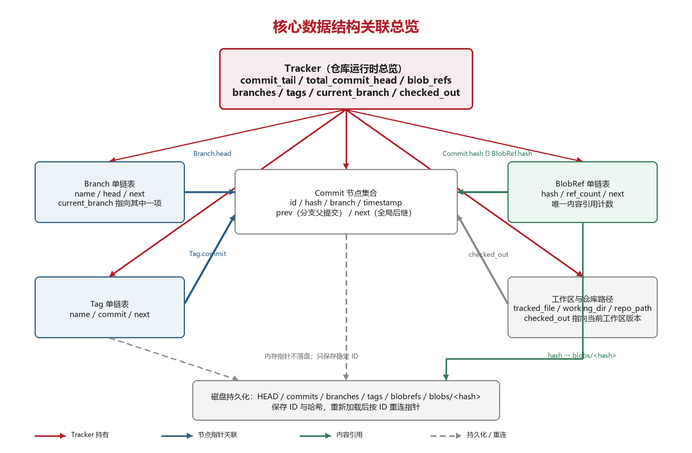
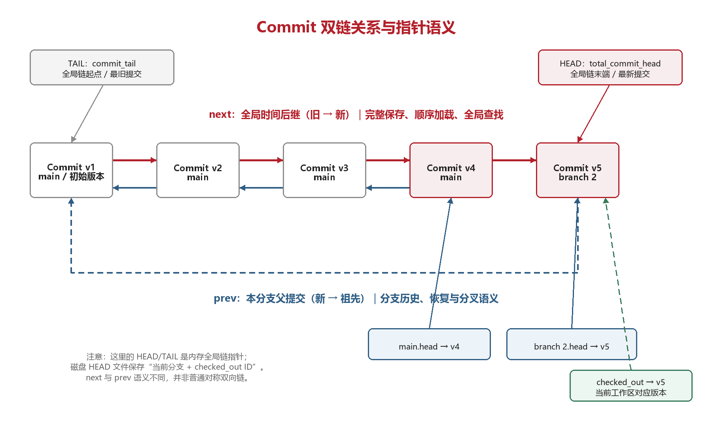
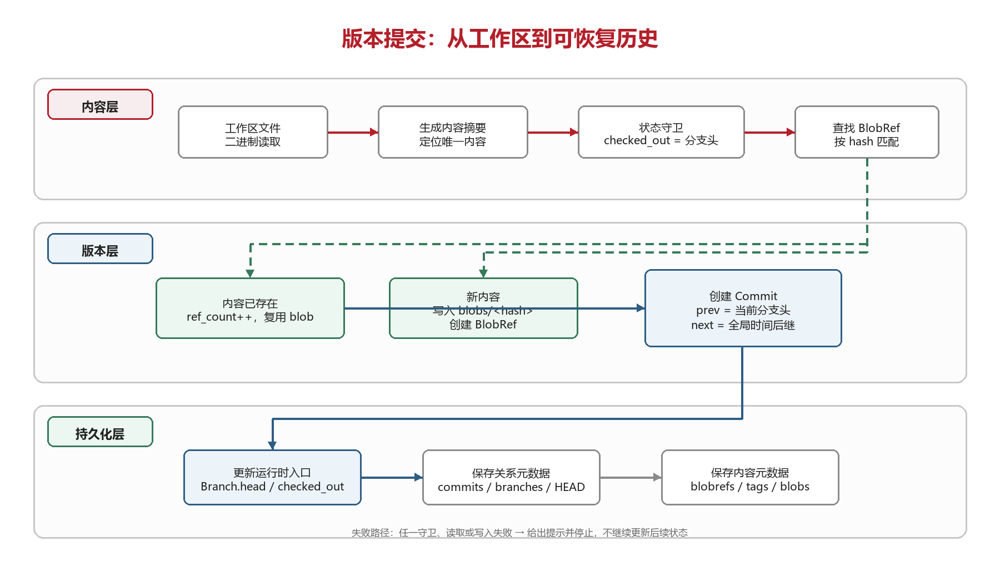
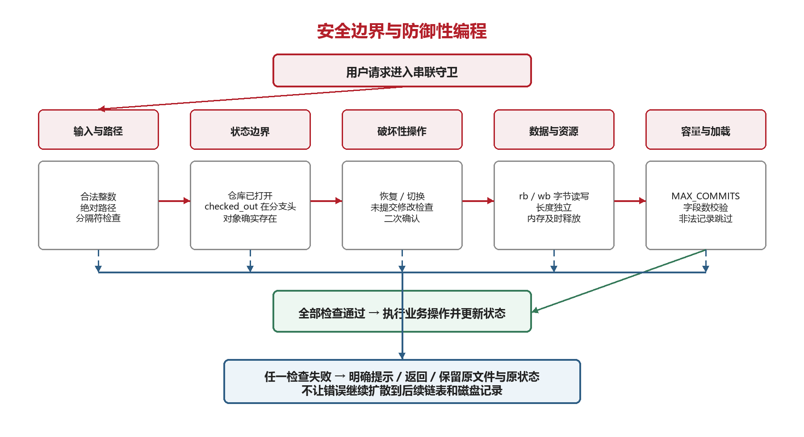
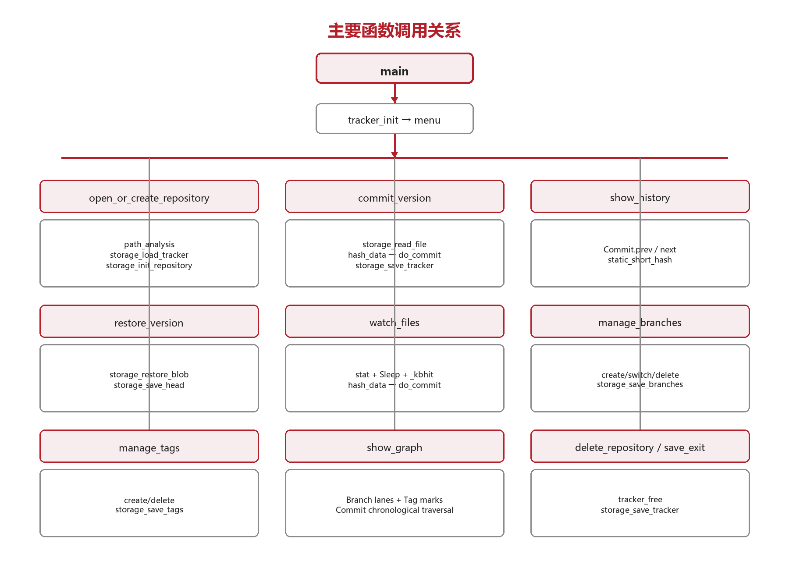

# 设计说明

本项目是一个基于 C 语言的本地文件版本管理工具。程序采用控制台菜单交互，用户通过输入编号完成仓库初始化、版本提交、历史查看、版本恢复、文件监控、分支管理、标签管理和提交图查看等操作。

## 1. 项目背景与定位

日常学习与设计工作中，图片、压缩包、可执行文件、模型文件等二进制文件同样会频繁修改。通用版本控制软件能够保存二进制对象，但对只想保护某一个本地文件、非文本文件的普通用户而言，安装、初始化、暂存和提交等操作显得偏重。本项目因此选择“单文件、菜单式、本地化”作为切入点，使用 C 语言与链表结构实现一个轻量版本管理工具。

系统以文件内容摘要区分版本，将版本元数据与实际内容分离：提交链表记录版本、分支和时间等信息，blob 目录按哈希保存版本快照，BlobRef 链表维护引用次数。用户可从控制台菜单完成全部操作，无需接触命令行参数。

**项目定位**：面向 Windows 的、聚焦单机、单文件、小规模历史记录场景的二进制单文件本地版本管理工具；全部功能从控制台菜单进入，不使用命令行参数。

本项目参考通用版本控制系统的核心思想（提交引用、分支头、检出状态、持久化重建），但有明确且主动的取舍：面向单机、单文件、二进制内容保护，刻意不实现暂存、网络传输、冲突合并和权限协作，而把注意力集中在提交节点、双链语义、分支入口、持久化重建和异常处理上。

### 核心术语

| 术语 | 含义 |
|------|------|
| 工作区 | 被管理的目标文件当前的实际内容 |
| blob | 按内容 SHA-256 哈希命名保存的一份物理内容快照；相同内容只保存一次 |
| 提交（Commit） | 一次版本记录，含 ID、说明、时间、内容哈希与分支归属 |
| 分支头（head） | 某分支上最新的提交节点，由 `Branch.head` 指向 |
| 检出版本（checked_out） | 工作区当前对应的提交节点；恢复历史版本后指向该历史节点，可与分支头不同 |
| HEAD 文件 | 磁盘上保存“当前分支名\|检出版本 ID”的元数据文件，用于恢复退出前状态 |
| mtime | 文件最后修改时间，监控功能的第一级变化判断依据 |

## 2. 总体设计

系统采用分层的面向过程结构。交互层负责菜单、状态显示、编号输入和二次确认；业务层实现版本管理各项功能；数据与工具层负责二进制读写、blob 管理以及元数据持久化。运行时状态集中在 `Tracker` 结构体中，程序退出前保存，重新打开仓库时再从磁盘重建链表。



从用户角度看，系统围绕“选择文件—保存版本—查看/恢复—组织历史”形成闭环。内容读取和哈希计算均按字节进行，因此文本文件和二进制文件均可处理。每个被管理文件对应一个独立子仓库；同一工作目录可通过 `.ft/index` 记录多个文件到子仓库的映射。

- **交互方式**：运行程序后输入 0—9 的菜单编号，关键操作均有确认或警告。
- **版本规模**：暂定 `MAX_COMMITS` 为 2048，提交 ID 从 1 递增，ID 0 留作退出等用途；越界或非法 ID 的记录在加载时会被跳过。
- **存储策略**：元数据使用文本文件形式保存，实际内容快照使用哈希命名的二进制 blob。
- **误操作防护**：恢复、切换分支前检查未提交修改；不在分支头时禁止直接提交或监控提交，防止破坏提交历史。



上图按用户可感知的功能而非源代码函数划分系统。打开或创建仓库是其他业务的前置条件；文件监控检测到真实内容变化后复用“保存当前版本”功能；历史记录为版本恢复提供选择依据；分支切换会将目标分支头恢复到工作区，历史、分支和标签则共同汇总到提交图中展示。

### 开发与运行平台

| 项目 | 配置/版本 | 说明 |
|------|-----------|------|
| 开发操作系统 | Windows 11，x64 | 代码使用 `windows.h`、`conio.h`、`Sleep`、`_kbhit`、`cls` 和 `pause`，当前实现面向 Windows |
| 构建系统 | CMake（最低 3.20） | `CMakeLists.txt` 指定 C11 并构建 `file_tracker` |
| 编译器 | MinGW-w64 GCC | GNU C 编译器，`x86_64-w64-mingw32` 目标 |
| 构建后端 | Ninja | 用于并行增量构建 |
| 硬件要求 | 普通 64 位 PC | 无需网络或数据库；内存、磁盘需求取决于操作的 blob 内容总量 |
| 依赖 | C 标准库及 Windows API | 无外部运行库、服务器或云服务依赖 |

### 关键技术

1. **文件内容摘要**。`lib.c` 在项目内部自实现 SHA-256，不依赖第三方库。任意长度文件先分组和填充，再经过 64 轮压缩，最终得到 32 字节摘要并转换为 64 个十六进制字符的哈希串。摘要既用于变化判断，也直接作为 blob 文件名。文件由 `storage_read_file` 以 `long`/`ftell` 一次性载入内存，因此单文件支持上限约 2 GB、内存占用与文件大小同量级；哈希按字节流分组处理，耗时与文件大小近似线性。
2. **链表组织版本关系**。`Commit.next` 形成“最旧到最新”的全局时间链，便于完整地线性保存、加载和查找全部提交；`Commit.prev` 指向当前分支的父提交，可跨越全局时间链形成分支依赖关系，便于恢复与分支历史遍历。`Branch` 和 `Tag` 通过提交指针连接到版本节点。
3. **内容去重与引用计数**。提交前遍历 `BlobRef` 链表查找哈希；已有哈希只增加 `ref_count`，新哈希才写入 `blobs/<hash>`。因此多个提交可引用同一份物理内容。
4. **二进制安全 I/O**。`storage_read_file` 使用 `rb` 模式读入字节数组，`storage_write_file` 使用 `wb` 模式精确写回；处理过程不依赖字符串结束符，能覆盖文本和二进制文件。
5. **两级变化检测**。监控模块先比较 mtime，变化时才读取文件并计算 SHA-256，减少不必要的整文件读取和哈希计算，同时避免“修改时间变化但内容相同”造成自动提交。
6. **文本元数据持久化**。`HEAD`、`commits`、`branches`、`tags`、`blobrefs` 使用竖线分隔记录（保存时拒绝分隔符注入），程序启动时按 ID 映射重建指针关系，格式简单、可检查。

### 设计取舍

本项目把版本管理概念抽象为可直接观察的 C 数据结构和磁盘文件，而不是简单的菜单功能复刻；每项设计都能在控制台、`.ft` 元数据和链表遍历中被验证。功能边界同样明确：`Commit` 只保留一个 `prev` 父提交，不支持多父合并提交；系统的“安全”主要指制止错误数据和用户输入崩溃、防止误覆盖和状态不一致，不提供身份认证、加密、并发锁或断电级原子事务等高级安全特性。

## 3. 详细设计

### 3.1 模块划分

项目采用精简的四文件分层，所有公开结构体与跨文件函数声明集中在 `tracker.h`。

| 模块 | 主要内容 | 职责边界 |
|------|----------|----------|
| `src/main.c` | `show_menu`、`menu`、`main` | 创建 `Tracker`，显示状态与菜单，将编号分派到各业务函数 |
| `src/tracker.c` | 版本 / 分支 / 标签 / 监控 / 提交图 | 维护内存对象、实现用户流程、检查操作前置条件，并调用 storage/lib |
| `src/storage.c` | 目录、blob、元数据、index | 以二进制模式保存内容，以文本格式保存可重建的 ID 与关系 |
| `src/lib.c` | 路径、输入、内容摘要 | 提供不依赖业务状态的通用函数及底层内容摘要能力 |
| `src/tracker.h` | 常量、结构体、接口 | 统一模块边界和数组容量，避免重复声明 |

数据流是单向收敛的：`main.c` 只负责入口与分派；`tracker.c` 实现业务流程和运行时链表；`storage.c` 完成仓库目录管理、二进制 blob 与元数据文件读写等磁盘 I/O；`lib.c` 提供通用支持。

### 3.2 数据结构设计

系统以 `Tracker` 作为运行时状态中心，集中保存目标文件路径、`Commit`、`BlobRef`、`Branch`、`Tag` 等链表以及 `current_branch` 和 `checked_out`。这种设计把“版本是什么”“内容存在哪里”和“用户如何组织历史”分开，各结构只承担一类稳定责任。



数据结构的关键思路是同时保留“全局记录顺序”与“分支逻辑祖先”两种不同关系。`Commit.next` 按提交产生时间串起全部节点，`Commit.prev` 只指向当前分支上的父提交。它们不是同一条链的两个对称方向，而是将全局管理和分支语义解耦的两类连接。



图中 `TAIL`（`commit_tail`）指向全局 `next` 链的起点，即最旧提交；`HEAD`（`total_commit_head`）指向全局链末端，即最新产生的提交。这里的 `HEAD`/`TAIL` 是内存链表指针，不同于磁盘 `HEAD` 文件。`main.head`、`branch.head` 和 `checked_out` 从不同语义入口指向具体 `Commit`，使“全局最新”“分支最新”和“工作区当前版本”能够明确区分。

- **全局 `next` 链**解决“完整保存和查找”问题。所有 `Commit` 按产生时间从旧到新串联，`storage_save_commits`、`storage_load_commits` 和 `find_commit_by_id` 都可只沿这一条链顺序处理。若只使用分支父链，来自其他分支的提交会在遍历某个分支时不可见，持久化也难以保证完整。
- **分支 `prev` 链**解决“历史语义和恢复”问题。新提交的 `prev` 只指向当前分支原 head；恢复与当前分支历史只沿 `prev` 追溯，因此不会把其他分支后来产生的提交误判为祖先。创建分支时把 `checked_out` 作为新 `Branch.head`，形成可解释的分叉点。
- **磁盘上保存提交 ID 而非指针**，加载后再按 ID 重连，避免地址持久化失效，实现链表、指针与持久化的协同。

以一次实测仓库为例（数据摘自 `.ft` 元数据文件，可逐行核对）：

```text
全局时间链（next，旧→新）：v1 → v2 → v3 → v4 → v5
分支父链（prev，各分支独立回溯）：
  main    ：v4 → v3 → v2 → v1   （branches: main|4）
  branch 2：v5 → v1             （branches: branch 2|5）
标签：tag 1 → v5
HEAD：branch 2|5
```

`v5` 是在恢复到 `v1` 并创建 `branch 2` 之后由监控自动提交产生的：它在全局链上排在 `v4` 之后（`next` 记录真实发生时间），`prev` 却跨过 `v2—v4` 直接指向 `v1`（`prev` 记录逻辑祖先）。沿 `branch 2` 的 `prev` 链回溯只会经过 `v5`、`v1`，不会把 `main` 上后来产生的 `v2—v4` 误判为祖先——这正是两条链解耦价值的直接证据。

### 3.3 主要数据类型

| 类型 | 主要字段 | 作用 |
|------|----------|------|
| `Commit` | `id`、`file_path`、`message`、`hash`、`branch`、`timestamp`、`prev`、`next` | 版本节点；`prev` 为分支父提交，`next` 为全局时间后继 |
| `BlobRef` | `hash`、`ref_count`、`next` | 记录唯一 blob 的哈希及被提交引用的次数 |
| `Branch` | `name`、`head`、`next` | 分支链表节点，`head` 指向该分支最新提交 |
| `Tag` | `name`、`commit`、`next` | 标签链表节点，直接指向被标记提交 |
| `Tracker` | 路径、加载状态、各链表、`current_branch`、`checked_out`、`next_commit_id` | 集中保存仓库全部运行时状态 |

`lib.c` 另有仅本文件可见的 `sha256_ctx`，保存 64 字节分组缓冲、8 个状态字和已处理字节计数。结构体之间通过指针关联，磁盘持久化时使用提交 ID 代替地址，加载后再重建指针。

### 3.4 存储设计

初始化后在目标文件所在目录创建以下结构：

```text
目标文件所在目录/
└─ .ft/
   ├─ index
   └─ repos/
      └─ <文件名>/
         ├─ HEAD
         ├─ commits
         ├─ branches
         ├─ tags
         ├─ blobrefs
         └─ blobs/
            └─ <64字符SHA-256哈希>
```

| 文件/目录 | 记录格式 | 用途 |
|-----------|----------|------|
| `index` | `文件名\|目标文件完整路径` | 在同一工作目录中定位各单文件子仓库 |
| `HEAD` | `当前分支名\|checked_out提交ID` | 恢复上次退出时的分支和检出状态 |
| `commits` | `id\|路径\|说明\|hash\|分支\|prev_id\|时间戳` | 按行重建全部 `Commit` 与父提交关系 |
| `branches` | `分支名\|head_id` | 重建分支链表及分支头 |
| `tags` | `标签名\|commit_id` | 重建标签到提交的指向 |
| `blobrefs` | `hash\|ref_count` | 重建唯一内容引用计数 |
| `blobs/<hash>` | 原始二进制字节 | 实际版本内容；哈希相同则复用 |

### 3.5 版本提交流程



提交分成内容层、版本层和持久化层。文件先以二进制方式读取并定位唯一内容；状态守卫确保当前处于分支头；`BlobRef` 查找决定复用旧 blob 还是写入新 blob。随后创建 `Commit`，更新 `Branch.head` 与 `checked_out`，最后保存可用于重建的元数据。

提交节点的 `prev` 指针绑定当前分支原头，确保新提交继承正确的父版本；`next` 指针只反映提交发生的全局时间顺序。两个方向语义分开后，既能完整保存所有分支，又能从任一分支头追溯祖先。手动提交和监控提交复用统一的 `do_commit`，避免两套存储逻辑。

### 3.6 版本恢复与分支切换

恢复时仅在当前分支的 `prev` 链上查找 ID。找到后先展示分支、时间、完整哈希和说明，并比较工作区哈希与 `checked_out` 哈希；若存在未提交修改，必须再次确认。随后 `storage_restore_blob` 将 blob 字节写回原路径，`checked_out` 改为目标节点并保存 `HEAD`。

分支创建从当前 `checked_out` 分叉；切换分支前同样检查未提交修改，并恢复目标分支 head 的内容。若分支尚无提交，则只更新 `current_branch`，`checked_out` 置空。`main` 分支和当前分支均禁止删除。

典型场景是“在旧版本上继续修改而不破坏既有历史”：用户恢复到历史版本后，主菜单显示“当前 v1、最新 v4”，此时直接提交与监控均被阻止；用户在分支管理中创建新分支，新分支的 head 即为当前检出的 `v1`，随后的提交以 `v1` 为父版本继续演化，而 `main` 上 `v1→v4` 的历史保持完整。

### 3.7 文件监控算法

监控入口记录当前 mtime 和哈希。循环每 100 ms 检查键盘，以便用户退出；累计 5000 ms 后读取 `stat`。mtime 未变化直接进入下一轮，mtime 变化则读取文件并计算新哈希。只有新旧哈希不同才以“自动监控提交”为说明调用 `do_commit`。该设计兼顾响应性和 I/O 开销。与手动提交一致，监控入口同样要求 `checked_out` 处于分支头，否则直接拒绝进入监控并提示先创建分支。

### 3.8 文件内容摘要（SHA-256）

1. 初始化 8 个 32 位状态字和 64 个标准轮常数 K。
2. 逐字节写入 64 字节缓冲区；每收满一块调用 `sha256_transform`。
3. 末尾追加 `0x80`、补零，并在最后 8 字节写入原消息位长度。
4. 将每块扩展成 64 个消息字，执行 Ch、Maj、Σ0、Σ1 等 64 轮压缩。
5. 把最终 8 个状态字按大端顺序输出为 32 字节摘要，再格式化为 64 字符十六进制哈希。

### 3.9 安全边界与防御性编程

安全控制不集中在某一个函数中，而是以一组串联守卫贯穿用户请求。任意一层检查失败都立即返回，不继续改动链表或磁盘状态。



- **输入与路径边界**：`choice_check` 循环读取合法整数并清空异常输入；`path_analysis` 要求绝对路径、处理引号和分隔符后再拆分工作目录与文件名。仓库按目标文件创建独立子目录，避免一个文件的元数据与另一个文件混用。
- **状态边界**：`checked_out` 用于区分“当前工作区版本”与“分支最新版本”。当 `checked_out` 不等于 `current_branch->head` 时，提交和监控均被阻止，并提示先创建分支。
- **破坏性操作边界**：恢复和切换分支前会重新读取工作区、计算哈希并与 `checked_out` 比较；若发现未提交修改，必须再次确认。删除仓库也必须二次确认。
- **数据与资源边界**：文件内容始终以 `rb`/`wb` 字节方式读写，长度独立于字符串结束符；读取后的动态内存在取消或完成路径中释放。对于路径解析失败、仓库未打开、版本/分支/标签不存在及写入失败，函数返回并给出提示，而非继续执行后续状态更新。
- **容量边界**：提交 ID 与加载映射数组以 `MAX_COMMITS`（2048）为上限。`storage_load_commits` 对越界或非法 ID 的记录跳过并提示，防止数组越界；元数据行经 `split_line` 严格校验字段数，不合法的行整行丢弃。

系统的安全目标是“单进程场景中的误操作防护与数据一致性”，而非对抗恶意篡改。

## 4. 代码设计

### 4.1 头文件

| 文件 | 头文件 | 用途 |
|------|--------|------|
| `main.c` | `stdio.h`、`stdlib.h`、`tracker.h` | 控制台 I/O、`system`/`exit`、公共接口 |
| `tracker.c` | `stdio.h`、`stdlib.h`、`string.h`、`windows.h`、`conio.h`、`sys/stat.h`、`tracker.h` | 业务逻辑、Windows 轮询键盘与时间、链表和文件状态 |
| `storage.c` | `stdio.h`、`stdlib.h`、`string.h`、`sys/stat.h`；Windows 下 `direct.h` | 二进制/文本文件读写、目录创建和字符串解析 |
| `lib.c` | `stdint.h`、`stdio.h`、`stdlib.h`、`string.h`、`tracker.h` | 固定宽度整数、输入、路径和 SHA-256 |

### 4.2 符号常量与常量数组

| 符号/数组 | 值或规模 | 含义 |
|-----------|----------|------|
| `MAX_PATH_LEN` | 260 | 目标路径、文件名和工作目录数组容量 |
| `MAX_MESSAGE_LEN` | 128 | 提交说明最大长度 |
| `HASH_LEN` | 65 | 64 个十六进制字符的哈希串加字符串结束符 |
| `BRANCH_NAME_LEN` / `TAG_NAME_LEN` | 64 / 64 | 分支名和标签名数组容量 |
| `MAX_COMMITS` | 2048 | 提交映射和遍历数组上限 |
| `MONITOR_TIMES` | 5000 ms | 文件监控的完整检查周期 |
| `HASH_DISPLAY_LEN` | 7 | 界面显示的短哈希长度 |
| `REPO_PATH_LEN` / `STORAGE_PATH_LEN` | 324 / 452 | 仓库和内部存储路径缓冲区容量 |
| `BUF_SIZE` | `"63"` | 与 `BRANCH_NAME_LEN` 联动的输入宽度字符串宏（预留，须随其同步增减） |

项目没有可变的文件级全局业务状态：`Tracker` 由 `main` 在栈上创建并以指针传入各业务函数；除只读常量数组 `K[64]` 外，数组均作为结构体字段或函数局部缓冲区使用。

### 4.3 函数总览

下表按源文件列出项目中的全部函数，包括仅文件内部使用的 `static` 函数。

| 函数 | 文件 | 含义 |
|------|------|------|
| `main` | main.c | 程序入口；初始化 `Tracker`、设置 UTF-8 代码页并进入菜单 |
| `show_menu` | main.c | 打印主菜单、仓库、分支和检出版本状态 |
| `menu` | main.c | 循环读取编号并分派 0—9 的功能 |
| `create_branch` | tracker.c | 内部辅助：申请并初始化 `Branch` 节点 |
| `tracker_init` | tracker.c | 初始化路径、链表、`main` 分支和提交编号 |
| `tracker_free` | tracker.c | 沿链表释放 `Commit`、`BlobRef`、`Branch`、`Tag` |
| `save_exit` | tracker.c | 保存仓库状态并在确认后退出 |
| `open_or_create_repository` | tracker.c | 读取绝对路径，加载或初始化单文件仓库 |
| `do_commit` | tracker.c | 内部统一提交：blob 去重、创建 `Commit`、更新分支头并保存 |
| `commit_version` | tracker.c | 手动提交交互、哈希展示、说明录入和二次确认 |
| `show_history` | tracker.c | 展示当前分支或全部提交历史 |
| `delete_repository` | tracker.c | 确认后清理当前工作目录的 `.ft` 并重置内存状态 |
| `restore_version` | tracker.c | 按 ID 恢复当前分支历史版本并更新 `checked_out` |
| `watch_files` | tracker.c | 轮询 mtime/哈希，真实变化时自动提交 |
| `manage_branches` | tracker.c | 创建、切换、删除分支并持久化 |
| `manage_tags` | tracker.c | 创建、删除标签并持久化 |
| `show_graph` | tracker.c | 以 ASCII 分支轨道输出提交图和标签 |
| `make_dir_if_needed` | storage.c | 目录不存在时创建，存在时验证类型 |
| `storage_repository_exists` | storage.c | 检查仓库目录是否已存在 |
| `storage_init_repository` | storage.c | 创建 `.ft/repos/<文件>/blobs` 和初始元数据 |
| `storage_read_file` | storage.c | 以 `rb` 模式读取任意文件到动态字节数组 |
| `storage_write_file` | storage.c | 以 `wb` 模式完整写入指定字节数组 |
| `storage_save_blob` | storage.c | 将唯一内容保存为 `blobs/<hash>` |
| `storage_restore_blob` | storage.c | 读取哈希对应 blob 并覆盖目标文件 |
| `repo_file_path` | storage.c | 内部辅助：拼接仓库元数据文件路径 |
| `strip_newline` | storage.c | 内部辅助：删除行尾 CR/LF |
| `split_line` | storage.c | 内部辅助：按 `\|` 原地切分字段 |
| `find_commit_by_id` | storage.c | 内部辅助：沿全局 `next` 链查找提交 |
| `storage_save_head` / `storage_load_head` | storage.c | 保存 / 加载当前分支和 `checked_out` ID |
| `storage_save_commits` / `storage_load_commits` | storage.c | 保存 / 加载提交并重建 `prev`/`next` |
| `storage_save_branches` / `storage_load_branches` | storage.c | 保存 / 加载分支并用 ID 连接提交 |
| `storage_save_tags` / `storage_load_tags` | storage.c | 保存 / 加载标签并验证目标提交存在 |
| `storage_save_blobrefs` / `storage_load_blobrefs` | storage.c | 保存 / 重建 `BlobRef` 单链表 |
| `storage_save_tracker` / `storage_load_tracker` | storage.c | 按依赖顺序保存 / 加载全部仓库状态 |
| `storage_ft_write_index` / `storage_ft_open_index` | storage.c | 向 `.ft/index` 写入 / 查询文件名映射 |
| `rotr32` | lib.c | 内部辅助：32 位循环右移 |
| `sha256_init` / `sha256_transform` / `sha256_update` / `sha256_final` | lib.c | SHA-256 内部步骤 |
| `path_analysis` | lib.c | 规范斜杠/引号并拆分工作目录和文件名 |
| `hash_data` | lib.c | 对给定字节数组计算 64 字符 SHA-256 |
| `storage_text_is_safe` | lib.c | 检查字符串是否包含分隔符 `\|` |
| `choice_check` | lib.c | 循环读取合法整数并清空输入缓冲 |
| `static_short_hash` | lib.c | 返回前 7 位哈希的静态显示缓冲 |



调用关系以 `menu` 为分派中心。业务函数直接访问 `Tracker`，并通过 `tracker.h` 暴露的 `storage_*`、`hash_data`、`path_analysis`、`choice_check` 等接口完成底层工作；`storage.c` 的解析辅助函数和 `lib.c` 的 SHA-256 内部函数均保持文件内可见。

## 5. 已知限制与改进方向

1. 元数据保存尚未采用原子写入、文件锁和崩溃恢复日志，多进程或意外中断时仍有一致性风险。
2. 提交入口未拦截超过 `MAX_COMMITS` 的新提交，超限记录在下次加载时会被跳过。
3. `Windows API` 与 `system` 命令限制了跨平台能力。

后续可增加提交删除与引用回收、原子写入、文件锁、哈希流式计算和单元测试，并把平台相关监控与终端操作封装为适配层。
