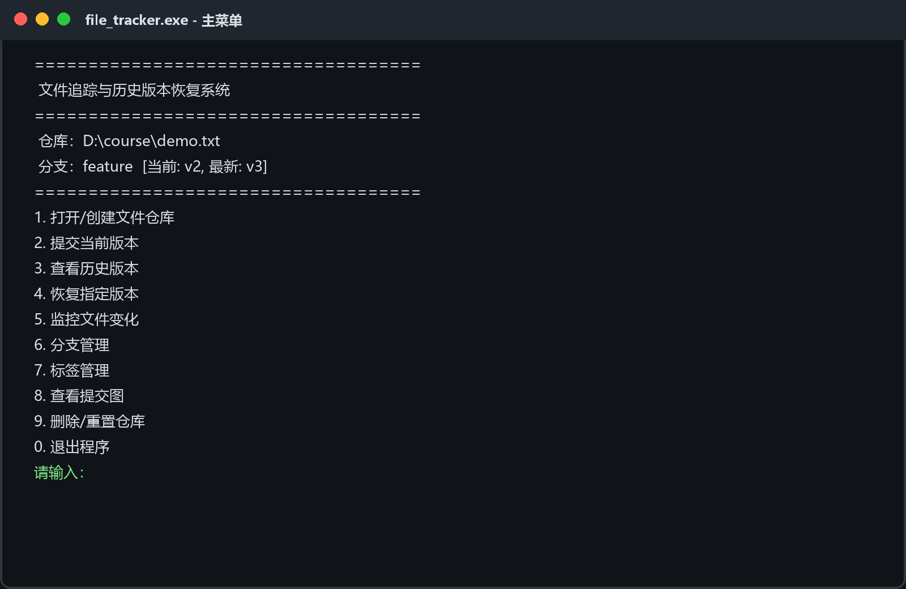
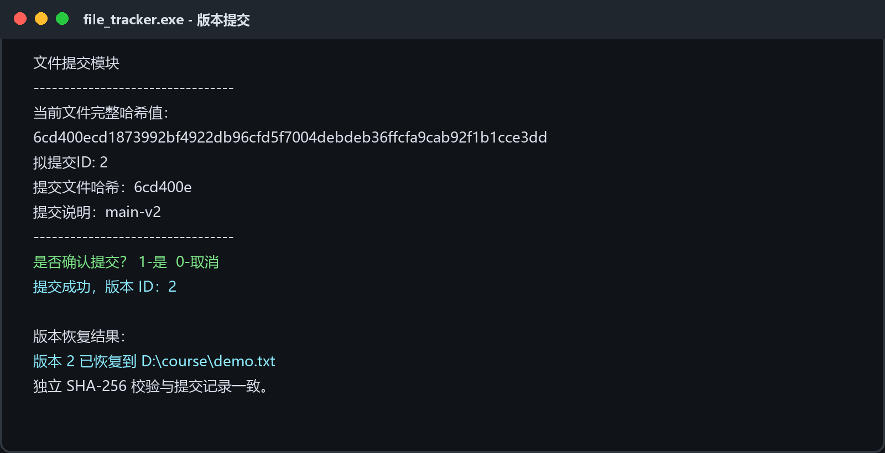
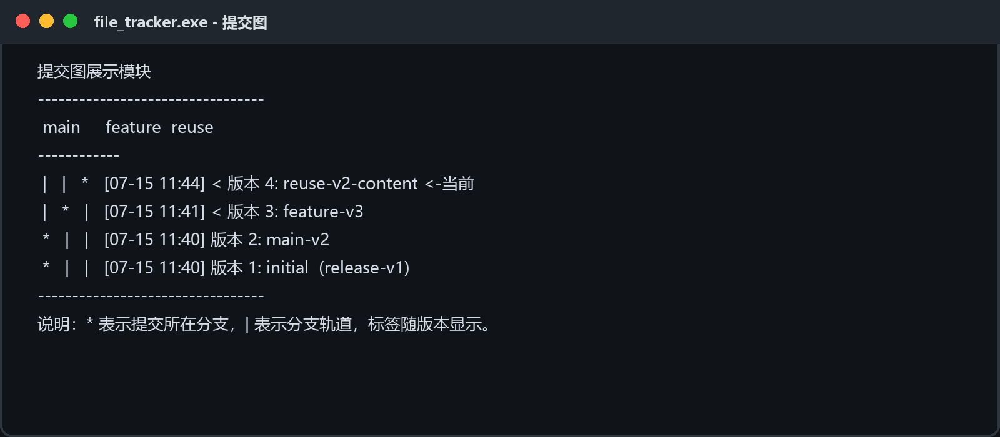

# 使用说明

本程序采用控制台菜单交互。运行后根据菜单提示输入功能编号即可完成操作，无需记忆命令行参数。

## 1. 主菜单

```text
====================================
 文件追踪与历史版本恢复系统
====================================
 仓库：未打开
====================================
1. 打开/创建文件仓库
2. 提交当前版本
3. 查看历史版本
4. 恢复指定版本
5. 监控文件变化
6. 分支管理
7. 标签管理
8. 查看提交图
9. 删除/重置仓库
0. 退出程序
请输入操作编号：
```

菜单顶部持续显示当前仓库、分支和检出位置。业务子页使用分隔线组织信息；提交、恢复、分支切换和仓库删除均要求确认。



主菜单中“当前 v2、最新 v3”表示工作区已恢复到历史版本，而当前分支头仍为 v3。此状态下直接提交和监控会被阻止，用户应先创建新分支，避免改写现有历史。

## 2. 功能说明

| 功能 | 用户可见行为 |
|------|--------------|
| 打开/创建文件仓库 | 输入绝对路径，解析工作目录和文件名；加载已有 `.ft` 数据，或创建独立子仓库及 `main` 分支 |
| 提交当前版本 | 二进制读取文件并生成内容摘要（标准 SHA-256），提交说明与时间；新内容存入 `blobs`；内容与上次提交相同时给出提示，确认后仍新建提交记录，但只增加引用计数、不重复保存 blob |
| 查看历史版本 | 可查看当前分支依赖链，也可按全局时间链查看全部提交；显示 ID、分支、时间、短哈希和说明 |
| 恢复指定版本 | 在当前分支的 `prev` 链上按 ID 查找，展示版本详情；检查工作区未提交修改后，用目标 blob 覆盖原文件 |
| 监控文件变化 | 每 5 秒检查修改时间；mtime 变化后再计算哈希，确定内容变化时调用统一提交函数自动提交 |
| 分支管理 | 创建分支时指向当前检出版本；切换时恢复目标分支头；支持删除非 `main`、非当前分支 |
| 标签管理 | 为任意有效提交 ID 创建命名标签，可按序号删除；标签与提交图一起持久化显示 |
| 查看提交图 | 将分支映射为最多 8 条 ASCII 轨道，按新到旧打印提交、分叉、当前版本和标签 |
| 删除/重置与退出 | 可在二次确认后删除当前工作目录的 `.ft`；退出时统一保存 `commits`、`branches`、`tags`、`blobrefs` 和 `HEAD` |



提交页展示拟提交 ID、版本说明和二次确认信息，便于最终写入前核对。恢复页先显示目标版本详情，再覆盖工作区文件；恢复后的文件内容与目标提交一致。

除成功路径外，误操作防护类输出同样是界面的重要组成。以下两类警告在非分支头状态下阻止提交/监控，或在恢复（切换分支）会覆盖未提交修改时要求再次确认：

```text
警告：当前未处于提交头，如需在此版本上提交，请先新建分支！

警告：当前文件有未提交的修改！恢复版本 1 将丢失这些修改。是否仍然继续？
1-是  0-取消
```



提交图将每个分支映射为一条轨道：星号表示提交所属分支，竖线维持其他分支轨道，`<` 提示相邻记录发生分支变化，当前版本和标签直接附在提交后。该方式不依赖图形库，适合纯控制台环境。

## 3. 快速测试流程

以下是一个完整的演示流程。请先准备一个测试用的文本文件（例如用记事本在 `C:\test\hello.txt` 里写一行 `Hello World v1`）。

> 目标文件（如 `hello.txt`）使用**绝对路径**输入，且该文件的父目录必须已存在。

### 步骤 1：初始化仓库

输入 `1`，然后输入目标文件的绝对路径，例如：

```text
请输入目标文件路径：C:\test\hello.txt
```

预期输出：`仓库目录已创建/初始化成功`。此后菜单顶部会显示已加载的仓库名称和分支。

### 步骤 2：提交版本

输入 `2`，按提示输入提交说明（例如 `第1次提交`）。

预期输出：显示版本 ID（如 `v1`）、SHA-256 哈希值前 7 位。程序会自动将文件内容保存为 blob。此时可在 `C:\test\` 目录下看到程序自动创建的 `.ft\` 目录（隐藏目录）。

### 步骤 3：多次修改并提交

用记事本修改 `C:\test\hello.txt` 内容（例如改为 `Hello World v2`），保存后回到程序再次输入 `2` 提交；重复一次生成 `v3`。相同内容不会重复保存 blob。

### 步骤 4：查看历史版本

输入 `3`，列出所有提交记录，含版本号、所属分支、SHA-256 前 7 位、时间戳、提交说明，按时间倒序排列。

### 步骤 5：恢复指定版本

输入 `4`，输入版本编号（如 `1`）恢复到 `v1`。用记事本打开 `C:\test\hello.txt`，内容应为 `Hello World v1`。

### 步骤 6：分支管理

输入 `6`，进入分支管理子菜单：

```text
=== 分支管理 ===
1. 创建新分支
2. 查看所有分支
3. 切换分支
4. 删除分支
0. 返回
```

1. 选择 `1`，输入分支名（如 `dev`）→ 创建成功。
2. 选择 `2` → 可看到 `main` 和 `dev` 两个分支，当前分支标注 `*`。
3. 选择 `3`，切换到 `dev`。
4. 回到主菜单，再提交一版（`v4`）→ `v4` 属于 `dev` 分支。
5. 再次进入分支管理 → 切换到 `main` → 查看历史，会发现 `v4` 不在 `main` 分支的历史中。

### 步骤 7：标签管理

输入 `7`，进入标签管理子菜单：

```text
=== 标签管理 ===
1. 创建标签
2. 删除标签
3. 查看标签
0. 返回
```

1. 选择 `1`，输入标签名（如 `stable`），再输入要标记的版本 ID（如 `1`）。
2. 选择 `3` → 可看到已创建的标签。
3. 返回主菜单，输入 `8` 查看提交图，应能看到标签 `stable` 标注在对应版本上。

### 步骤 8：查看提交图

输入 `8`，输出 ASCII 字符绘制的提交历史图，展示主线分支、`dev` 分支的 fork 点，以及标签位置。

### 步骤 9：文件监控

输入 `5`，程序进入监控模式，持续检测目标文件是否发生变化：

```text
开始监控文件...（按0停止）
```

此时切换到记事本，修改 `C:\test\hello.txt` 并保存。程序会自动检测到变化并提交。按 `0` 停止监控，回到主菜单。输入 `3` 查看历史，应能看到监控期间自动生成的提交。

### 步骤 10：退出

输入 `0`，程序保存所有数据后退出。仓库数据保存在 `.ft\` 目录中；再次运行程序，输入 `1` 打开同一文件路径，程序会自动加载历史数据。
